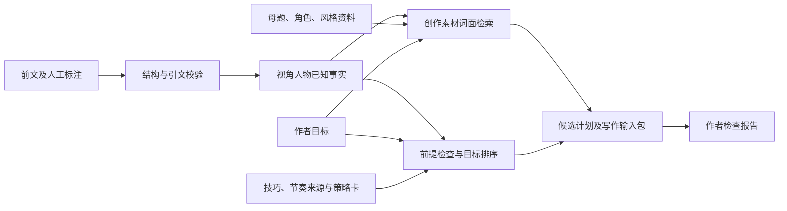

# 离线叙事推荐小样

本实验验证一条完整数据流：**前文事实 → 素材检索 → 技巧与节奏推荐 → 下一场戏的候选计划 → 写作输入包**。

样例《雨夜的铜钥匙》包含 3 个场景、6 条人工标注事实和 2 条未完成线索。视角人物林舟知道其中 5 条事实；另一人物掌握的秘密不进入林舟的写作输入包。当前版本输出计划，不生成小说正文。

## 运行

需要 Python 3.10 或更新版本，无第三方依赖。在仓库根目录运行：

```bash
python3 scripts/narrative_prototype.py \
  --project examples/narrative-prototype/story.json \
  --compare-goals
```

用浏览器打开生成的 `runtime-data/narrative-prototype/report.html`。页面可以切换三种已经运行的作者目标，查看推荐排序、前提不足的原因、事实引文、资料来源和最终写作输入。切换按钮只展示预计算结果，修改故事后需要重新运行脚本。

输出目录：

```text
runtime-data/narrative-prototype/       # 已被 Git 忽略
├── report.html                        # 可离线打开的交互报告
├── result.json                        # 原始作者目标的完整运行结果
├── writer_prompt.txt                  # 由真实上游结果组装的写作输入
└── comparison.json                    # 三个目标的结果，仅 --compare-goals 时写入
```

可用 `--output-dir` 指定输出目录；仓库内限 `runtime-data/`。可用 `--top-k 2` 调整候选数量，或用 `--goal raise_pressure` 覆盖原目标。目标可选 `recover_and_investigate`、`raise_pressure`、`reveal_truth`。不加 `--goal` 时保留故事文件中的具体目标描述，包括对比模式下的当前目标。

## 数据层及实际目录

技巧与节奏独立为推荐知识层；推荐算法负责读取它们、检查条件并排序。知识、规则和执行代码各有明确入口。

```text
novel-base/
├── examples/narrative-prototype/story.json   # 故事记忆：本书发生了什么、谁知道什么
├── assets/                                 # 原有 271 个文件，保持原目录
│   ├── motif_library/                      # 创作素材：178 份母题
│   ├── character_archetypes/                # 创作素材：45 份角色资料
│   ├── style_library/                       # 创作素材：9 份有效风格资料；另 2 份辅助文件
│   ├── technique_library/                  # 推荐知识：16 份技法、10 份场景资料；另 1 份报告
│   ├── pacing/                             # 推荐知识：4 份节奏资料；另 1 份报告
│   ├── ai_patterns.md                      # 推荐知识：1 份修订参考
│   ├── platforms/                          # 配置：3 份平台配置
│   └── ingest_manifest.json                # 辅助：导入记录
├── recommendation/cards.json                # 4 张结构化推荐策略卡
├── scripts/narrative_prototype.py            # 校验、检索、条件检查、排序及输入包组装
├── scripts/narrative_prototype_report.py     # 结果可视化
└── scripts/tests/test_narrative_prototype.py # 行为回归测试
```

资产索引分为创作素材 232 份、推荐知识 31 份、配置 3 份、辅助 5 份。报告、日志、风格索引和测试用风格不参与知识检索。这个版本统一运行时记录与引用格式，不批量改写原始 Markdown。推荐知识的 31 份文档构成可用来源目录，当前 4 张卡片只关联其中所需的文档，并未将全部文档转为规则。



## 怎样判断下一场戏

检索使用中文相邻双字与英文词的词面重合度。规则检查使用结构化事实、在场人物和线索状态，不依赖相似度猜测角色知道什么。

四个候选策略是：处理后果并调查、通过对话试探、继续增加压力、揭示有铺垫的真相。每张卡明确目标、场景功能、前提、建议步骤、预期作用、使用限制及参考文档路径。运行时读取真实参考段落并记录 SHA-256，便于核对来源；来源关联不表示人工规则已经得到文学质量验证。

先检查必要条件，再按公开规则排序：

| 条件或规则 | 当前行为 |
| --- | --- |
| 没有视角人物已知事实 | 不输出候选计划 |
| 调查、沿线索增加压力 | 必须有视角人物知道铺垫的未完成线索 |
| 人物对话 | 最近场景须有视角人物及另一角色在场，且至少共享一条事实 |
| 揭示真相 | 线索未完成、有早于答案的已知铺垫、视角人物已知答案、作者已允许揭示 |
| 通过前提检查 | 基础优先级 50 |
| 符合作者目标 | 加 40 |
| 连续两场强度至少为 4，考虑处理后果 | 加 15 |
| 连续高强度，作者又未要求继续加压 | 加压策略减 20 |
| 与最近场景功能相同 | 减 10 |

这些分数仅解释排序，不是概率，也不是小说质量评分。强度 1–5 来自人工标注。步骤属于创作提案，事实作为整份计划的核对依据；系统不会将任意事实配给某个步骤，声称已经证明两者存在因果关系。

原样例的预期表现：

| 作者目标 | 第一候选 | 揭示策略 |
| --- | --- | --- |
| 处理追逐后果并继续调查 | 处理后果，沿既有线索推进 | 被挡住 |
| 保持压力并推进当前目标 | 保持压力，推进未完成目标 | 被挡住 |
| 揭示真相 | 处理后果，沿既有线索推进 | 仍被挡住；目标不能覆盖人物知识和作者许可 |

揭示真相的目标当前无法实现时，页面给出仍可用的其他计划，并明确显示被挡住的策略。

## 换成自己的故事

复制 `story.json`，保留以下结构。场景必须有正整数顺序、1–5 的相对强度、场景功能和在场人物；事实必须有原文引文、所属场景和知情人物；线索引用事实 ID。所有场景、事实、线索 ID 必须唯一。

| 记录 | 关键字段 | 用途 |
| --- | --- | --- |
| 故事 | `project_id`、`pov_character`、`characters`、`goal` | 确定视角及作者意图 |
| 场景 | `id`、`order`、`text`、`function`、`tension`、`present_characters` | 标记时间顺序、强度与在场人物 |
| 事实 | `id`、`text`、`scene_id`、`quote`、`known_by` | 提供可定位、按人物过滤的故事记忆 |
| 线索 | `id`、`description`、`status`、`setup_fact_ids`、`resolution_fact_id`、`reveal_allowed` | 区分铺垫、答案与揭示许可 |

事实引文必须出现在对应场景中。此检查只验证原文定位，事实解释与知情范围仍需作者核对。原文引文留在作者报告，写作输入包只携带筛选后的事实文本及来源定位，避免整段引文夹带视角人物未知的信息。报告供作者审阅，不应整体作为未来模型的写作上下文。

当前揭示条件采取保守定义：视角人物已经知道答案之后才允许安排揭示。描写人物在下一场首次发现真相，需要另设“发现过程”策略以及信息获得条件，不应直接放宽现有检查。

## 验证与后续接口

```bash
python3 -m unittest discover -s scripts/tests -p 'test_narrative_prototype.py' -v
```

测试检查真实资产分类与哈希、目标影响排序、人物知识与共同事实、铺垫时间及揭示许可、上下文组装、HTML 转义、路径保护、重复运行的确定性和输入不被修改。

`run_pipeline(project, repo_root, cards_path=None, top_k=3)` 返回 JSON 可序列化字典；`build_catalog(repo_root)` 返回资产记录。每份候选计划的 `context_packet` 已经实际写入 `writer_prompt`，可以作为下一阶段模型适配器的输入边界。

目前每次运行会在本地扫描资产并读取可用文档，写作输入只组装选中的事实、最多 4 份创作素材参考及相关策略资料。尚无模型调用、持久化向量索引、自动事实抽取、自动正文续写、作者确认后的状态回写，也未改动现有 QMD 或写作链路。

下一阶段可以先让作者选择一份计划，再接写作模型；随后将词面检索替换为向量召回与重排，保留人物知识和线索许可检查。评估应比较建议与前文的一致性、目标适配和作者选择情况；这个小样尚不能证明推荐提升了创作质量。
